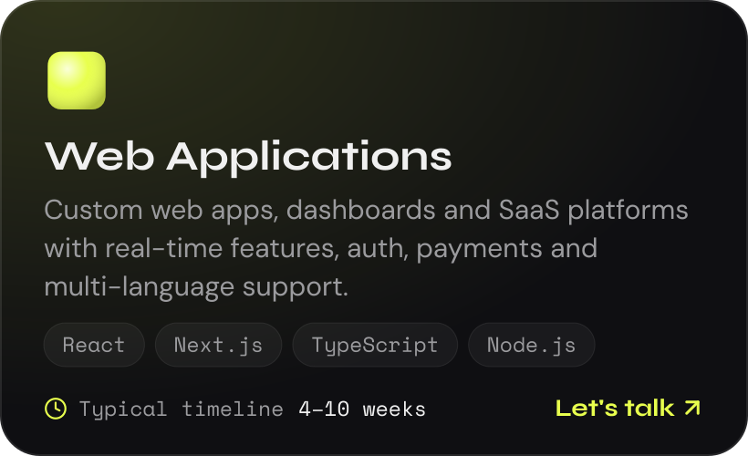
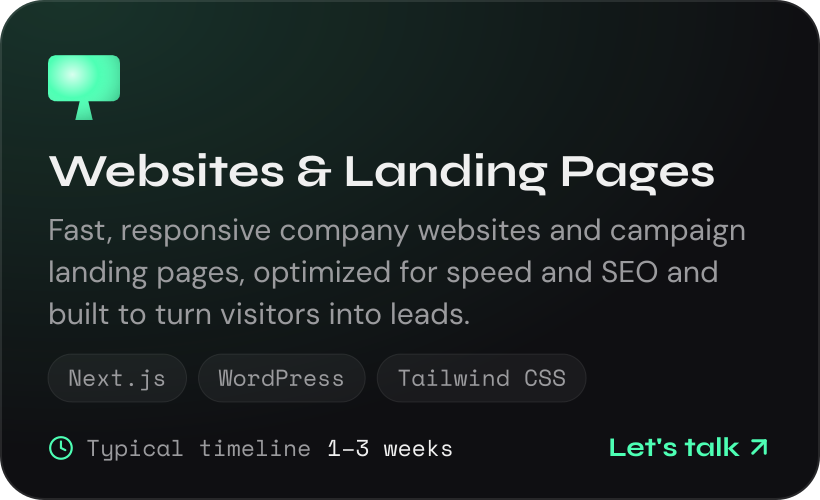
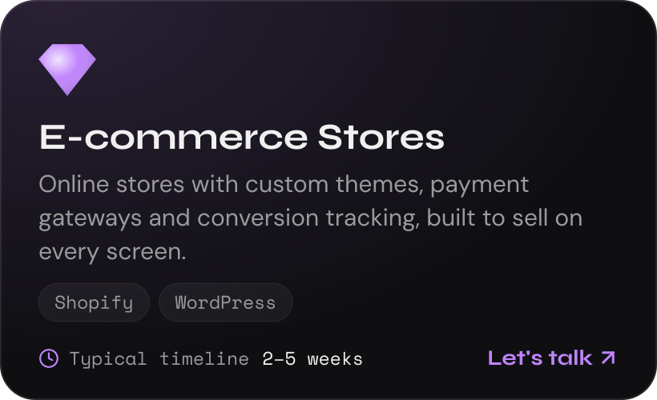
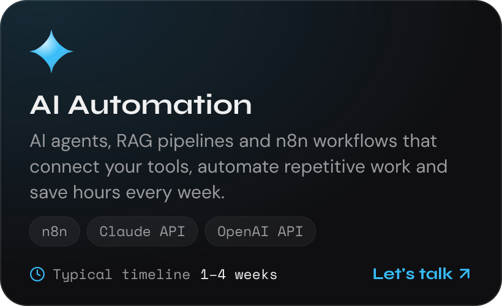
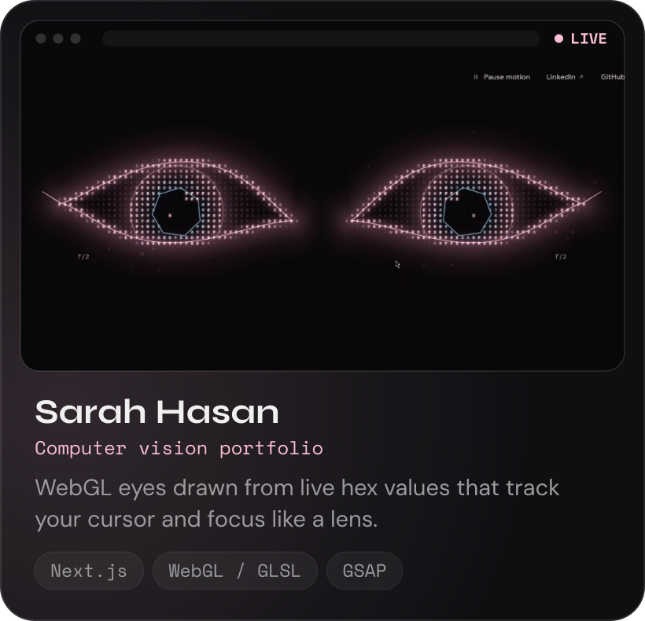
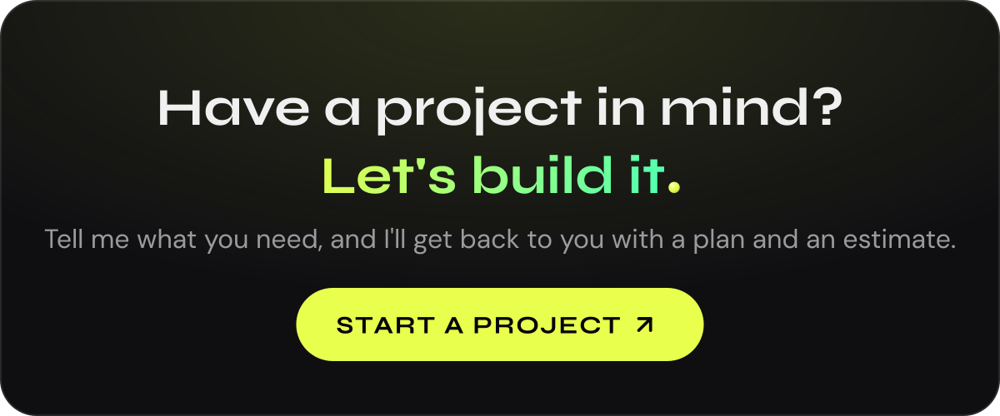

Building web applications, e-commerce stores and AI automations that help businesses move faster and work smarter.

## What I build

## Selected work

[See the rest of my work on my portfolio](https://portfolio-coral-zeta-34.vercel.app/#projects).

## Stack

- **Frontend:** `React` `Next.js` `TypeScript` `Redux` `React Query` `TailwindCSS` `ShadCN`
- **Motion and 3D:** `GSAP` `Framer Motion` `WebGL / GLSL`
- **Backend and data:** `Node.js` `Express` `MongoDB` `Supabase` `Pusher`
- **CMS and commerce:** `WordPress` `Shopify`
- **AI and automation:** `n8n` `Claude API` `OpenAI API` `pgvector`

## Right now

- **Web Developer at Nael Marketing Agency, Dubai.** WordPress, Shopify and custom React and Next.js sites, landing pages and stores for the agency and its clients.
- **Open to freelance and remote projects** alongside that.

**Before that:** Frontend Engineer at FutureX Digital Solutions (2026), Frontend Developer at Davinda (2025), Frontend Developer at York British Academy (2024).

> "I've received wonderful feedback about you; your work is excellent and your commitment is outstanding."
>
> Waleed AL-Barghouthi, Manager at FutureX

